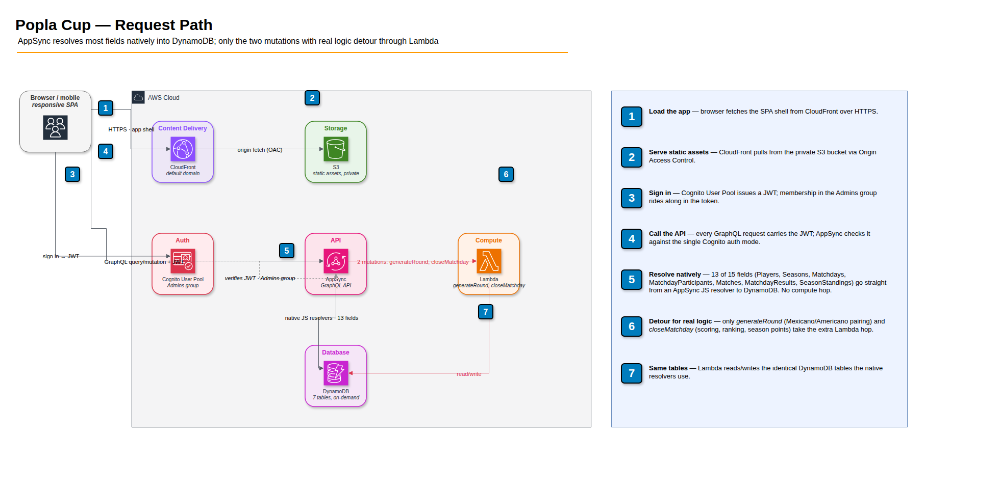
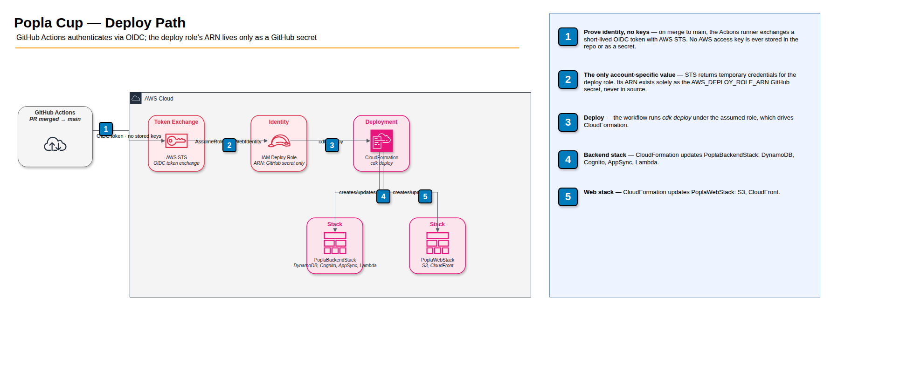

# Popla Cup — Architecture

Companion to `SPEC.md`. Describes the target AWS serverless architecture and
the CDK/CI setup that deploys it.

## Diagrams

AWS architecture diagrams, drawn with official AWS4 icons, live in
[`docs/`](docs/) as draw.io files — open them in
[diagrams.net](https://app.diagrams.net), the draw.io desktop app, or the
VS Code draw.io extension:

- [`docs/popla-request-path.drawio`](docs/popla-request-path.drawio) —
  browser → CloudFront/S3 and browser → AppSync, with the native-vs-Lambda
  resolver split front and center: reads and most writes resolve
  **natively** (an AppSync JS resolver straight to DynamoDB, no compute in
  between); only `generateRound` (Mexicano/Americano pairing) and
  `closeMatchday` (scoring, ranking, season-points transaction) — the two
  mutations with real algorithmic content — detour through Lambda before
  reaching the same tables. Rendered:
  
- [`docs/popla-deploy-path.drawio`](docs/popla-deploy-path.drawio) — how a
  merged PR reaches AWS: GitHub Actions exchanges a short-lived OIDC token
  with AWS STS to assume an IAM deploy role (no stored AWS keys), then
  runs `cdk deploy` against CloudFormation to update `PoplaBackendStack`
  and `PoplaWebStack`. The one account-specific value in that whole flow —
  the deploy role's ARN — exists solely as the `AWS_DEPLOY_ROLE_ARN`
  GitHub secret, which is why it never surfaces in source or in this
  repo's Actions logs, even though `cdk deploy` itself prints ARNs that
  contain it. Rendered:
  

Rendered PNGs are checked in so the diagrams show up inline on GitHub
(which doesn't render `.drawio` XML); regenerate them from the source
files whenever the diagrams change, since nothing enforces they stay in
sync automatically.

## Stack Overview

- **Frontend:** React + Vite + TypeScript (`web/`). A plain `fetch`-based
  GraphQL client rather than Apollo/Amplify — the API surface is small
  enough that a full client library isn't worth the dependency weight.
  Cognito auth via `amazon-cognito-identity-js`, `USER_SRP_AUTH`
  (phone number + password) only — see the Auth section below.
- **Frontend hosting:** S3 (private, Origin Access Control) + CloudFront.
  CloudFront attaches security headers to every response
  (`infra/lib/web-stack.ts`): a Content-Security-Policy that only lets
  the page load its own scripts, Google Fonts, and talk to AppSync and
  Cognito in the deploy region, plus HSTS and a no-framing rule. Anything
  new the frontend loads from another origin (a script, a font, an API)
  has to be added to that policy, or the browser blocks it.
- **API:** AWS AppSync (GraphQL), Cognito User Pool authorizer.
- **Business logic:** AppSync JS (native) resolvers to DynamoDB for CRUD/
  reads and simple writes; Lambda resolvers for the two operations with
  real algorithmic logic (round generation, matchday close).
- **Data:** DynamoDB, one table per entity (not single-table design — this
  app's scale and access patterns don't warrant the added complexity).
- **Auth:** Cognito User Pool, `Admins` group, phase-2 federated social
  login (Google etc.) on the same pool.
- **IaC:** AWS CDK (TypeScript), two stacks (`PoplaBackendStack`,
  `PoplaWebStack`).
- **CI/CD:** GitHub Actions, deploying via `cdk deploy`, authenticated to
  AWS via GitHub OIDC (no long-lived access keys).
- **Domain:** default CloudFront/AppSync endpoints for now; Route53 + ACM
  custom domain to be added later, in front of both the web distribution
  and the API.

## Data Model (DynamoDB)

Plain multi-table design. Each table below is a physical DynamoDB table.

### `Players`
- PK: `playerId`
- Attributes: `displayName`, `phone` (optional, international, digits
  only, no leading `+` — see Auth below), `cognitoSub` (nullable — set when an admin registers/
  changes the player's `phone`, via `AdminCreateUser`, not on first
  login; see Auth below), `createdAt`.
- Persists across seasons — this is the durable identity a matchday
  participant and season standings entry both point back to.
- A player with no `phone` is a **guest** (see SPEC.md) — `Player.isGuest`
  on the GraphQL type is computed as `!phone` in the `listPlayers`/
  `getMyPlayer` resolvers, not stored.
- GSI `byPhone`: PK `phone` — sparse (guests are absent from it, having no
  `phone`). Used by `getMyPlayer` and the `setMatchdayJoining` Lambda to
  resolve "which Player is the caller" from `ctx.identity.username`
  (Cognito Username == phone number — see Auth below).

### `Seasons`
- PK: `seasonId`
- Attributes: `name`, `status` (`ACTIVE` | `CLOSED`), `startDate`,
  `closedAt`.

### `Matchdays`
- PK: `matchdayId`
- Attributes: `seasonId`, `date`, `startTime` (optional time-of-day —
  kept as a separate attribute rather than folding into `date` so
  existing rows don't need migrating), `format` (`MEXICANO` |
  `AMERICANO`), `status` (`SETUP` | `IN_PROGRESS` | `CLOSED`),
  `selfRegistrationEnabled` (whether a non-admin caller may target
  themselves via `setMatchdayJoining` while `SETUP` — see SPEC.md's
  Registration), `maxParticipants`/`joinedCount` (an optional cap +
  its atomic counter, meaningful independent of
  `selfRegistrationEnabled` — applies to *any* join, self- or
  admin-added. Both absent when uncapped; `joinedCount` is
  internal bookkeeping for `set-matchday-joining`'s capacity-check
  transaction only, not exposed on the GraphQL type).
- GSI `bySeasonId`: PK `seasonId`, SK `date` — list matchdays in a season,
  chronologically.

### `MatchdayParticipants`
- PK: `matchdayId`, SK: `playerId`
- The registered participant list for a matchday. Count must be a
  non-zero multiple of 4 by the time `generateRound` first runs (see
  Resolver Split below) — not enforced before that, so the roster can
  sit at any size (including zero) while still `SETUP`.
- Attributes `status` (`JOINING` | `WAITLISTED` | `DECLINED`) and
  `updatedAt`, both written by every writer now (`createMatchday`,
  `setMatchdayJoining`) — a row with no `status` pre-dates this
  entirely and reads as `JOINING` wherever it's read
  (`generateRound`, `listMatchdayParticipantIds`,
  `listMatchdayParticipants`'s response mapper). `updatedAt` orders
  waitlist promotion FIFO, and separately powers "who registered
  when" (`listMatchdayParticipants`, sorted client-side: newest-first
  for `JOINING`, oldest-first — queue order — for `WAITLISTED`).

### `Matches`
- PK: `matchdayId`, SK: `ROUND#<n>#COURT#<c>`
- Attributes: `round`, `court`, `team1PlayerIds` (2), `team2PlayerIds`
  (2), `team1Games`, `team2Games`, `status` (`PENDING` | `COMPLETE`).
- One item per set (N/4 courts per round, one or more rounds per
  matchday — see SPEC.md).

### `MatchdayResults`
- PK: `matchdayId`, SK: `playerId`
- Attributes: `setsWon`, `gamesWon`, `gamesLost`, `gameDiff`, `rank`,
  `seasonPoints`, `winnerPoint` (bool — see SPEC.md's Winner Points),
  `seasonId` (denormalized for reference).
- Written once, by the `closeMatchday` Lambda, from the completed
  `Matches` for that matchday.
- GSI `byMatchdayRank`: PK `matchdayId`, SK `rankScore` (number) — a
  precomputed 3-level encoding of `(gamesWon, gameDiff, setsWon)`, each
  level given enough headroom that it dominates the levels below it, so
  a plain descending `Query` returns the day ranking (games won desc,
  then game diff desc, then sets won desc — see SPEC.md's Day Ranking)
  directly. No client-side or resolver-side sorting needed.
- GSI `bySeasonId`: PK `seasonId` only — lets `getSeasonWeightedRanking`
  pull every result row for a season in one `Query`.

### `SeasonStandings`
- PK: `seasonId`, SK: `playerId`
- Attributes: `totalPoints`, `matchdaysPlayed`, `winnerPoints` (sum of
  winner points across the season's closed matchdays — see SPEC.md).
- Incrementally updated (atomic `ADD`) by `closeMatchday`, in the same
  transaction as the `MatchdayResults` write.
- GSI `bySeasonPoints`: PK `seasonId`, SK `totalPoints` — descending
  `Query` gives the season leaderboard directly.
- GSI `bySeasonWinnerPoints`: PK `seasonId`, SK `winnerPoints` — same
  idea, for the "round winners" season ranking.
- Both indexes are queried from the `getSeasonRankingFn` Lambda (not a
  native resolver): excluding guests (see SPEC.md's Guest participants)
  needs a live join against `Players`, which a single-table native
  resolver can't do. See Resolver Split below.

### Backups

Every table above has `pointInTimeRecoverySpecification` enabled — 35
days of continuous point-in-time recovery, AWS's own restore mechanism.

On top of that, `BackupTablesFn` (`infra/lambda/backup-tables`) scans
every table above once daily (`BackupTablesSchedule`, 03:00 UTC cron)
and writes one plain JSON array per table to `BackupBucket`
(`s3://<bucket>/<YYYY-MM-DD>/<TableName>.json`), which expires objects
after 28 days via an S3 lifecycle rule. The bucket is versioned,
TLS-only (`enforceSSL`) and private, since these dumps include
participants' phone numbers; an expired snapshot's last version is
removed for good a week after it expires. This is deliberately a plain
`Scan` + `JSON.stringify`, not DynamoDB's native `ExportTableToPointInTime`:
these tables are tiny (low hundreds of items at most), so the RCU cost
of a daily scan is negligible, and a flat, human-readable JSON file per
table is far easier to inspect or restore from by hand than the native
export's sharded/manifest format — matching this repo's existing
`local/` reconciliation scripts' style, rather than requiring a
different restore process for a totally separate reason to reach for
one.

## Resolver Split

**Native (AppSync JS resolvers, direct to DynamoDB):**
- `listPlayers`, `getMyPlayer` — the latter is a `Players.byPhone` GSI
  query keyed on `ctx.identity.username`, returning the caller's own
  `Player` (or null); both compute `isGuest` (`!phone`) in the response
  mapper.
- `getSeason`, `listSeasons`
- `getMatchday`, `listMatchdaysBySeason`, `listMatchdayParticipantIds`,
  `listMatchdayParticipants` (the latter includes RSVP `status`, missing
  → `JOINING`)
- `listMatches(matchdayId, round?)`
- `getMatchdayRanking(matchdayId)` — Query on `MatchdayResults.byMatchdayRank`
- `createSeason`, `closeSeason`, `reopenSeason` — simple state changes.
  Only one `ACTIVE` season at a time is a UI-enforced convention, not a
  data-layer constraint — see Open Questions.
- `createMatchday` — writes the `Matchdays` item (`status: SETUP`,
  `selfRegistrationEnabled`, and `maxParticipants`/`joinedCount` if
  capped) plus a `JOINING` row per (optional, any-length) initial
  `participantId` — simple enough, still, to stay native even though it
  no longer validates a multiple of 4 up front (see `generateRound`
  below for where that check now lives).
- `recordSetResult(matchId, team1Games, team2Games)` — JS resolver
  validates the score (`max(team1Games, team2Games) == 6`,
  `min(...) < 6`, i.e. no tiebreak, no win-by-2 requirement) directly in
  the resolver's condition expression before the `UpdateItem`

**Lambda resolvers (real business logic):**
- `generateRound(matchdayId)` — determines the round number itself (one
  past the highest round already generated, or 1 if none yet — there's
  no fixed round count, see `SPEC.md`), reads current standings (round 1:
  the participant list, unranked; later rounds: the interim per-matchday
  standings computed from completed `Matches` so far — see note below),
  runs the Mexicano or Americano pairing algorithm per `SPEC.md` — for
  both formats, this also derives a partnership history (this matchday's
  prior `Matches`, split into "immediately previous round" vs "earlier")
  and weighs partner assignment against it, but at different scopes
  (`buildPartnershipHistory` in `infra/lambda/shared/pairing.ts`, which
  also holds `rankByStandingsSoFar`/`computeStandings` now — both pulled
  out of this Lambda so `infra/scripts/simulate-pairing.ts`, a local CLI
  for dry-running either format over synthetic players/rounds, can import
  the exact same logic instead of reimplementing it):
  - Mexicano: `courtsFromOrderedPlayers` buckets standings-ranked players
    into groups of 4, then picks each bucket's 2v2 split against the
    history — scoped to that one bucket only, since bucket composition is
    meaningful (it's the ranking).
  - Americano: `courtsFromGlobalRandomPairing` instead pairs up the
    entire field at once against the history (a bounded-retry greedy
    search, kept simple since a bucket-of-4's easy 3-way enumeration
    doesn't apply field-wide), then randomly groups the resulting
    partnerships two at a time into courts — Americano's groupings carry
    no meaning, so avoidance isn't confined to any bucket.

  Batch-writes the `Matches` items for that round. On round 1 specifically,
  this is also where "closing registration" now happens, folded into
  starting play instead of being its own mutation: validates a non-zero
  multiple of 4 `JOINING` participants (throwing otherwise, before any
  writes), deletes any still-`WAITLISTED`/`DECLINED` rows, and flips
  `Matchdays.status` from `SETUP` to `IN_PROGRESS` — which is what makes
  the matchday stop being editable (both by admin roster changes and,
  implicitly, self-registration).
- `closeMatchday(matchdayId)` — aggregates all generated rounds' complete
  `Matches`, computes each player's setsWon/gamesWon/gamesLost/gameDiff/
  rank/seasonPoints/winnerPoint, writes `MatchdayResults`, and atomically
  increments `SeasonStandings` (`totalPoints`, `matchdaysPlayed`, and
  `winnerPoints`) in a single DynamoDB transaction. Also flips
  `Matchdays.status` to `CLOSED`. The admin decides when to stop
  generating rounds and call this — there's no fixed round count.
  Winner-point eligibility (SPEC.md) needs the number of rounds played,
  taken as the highest `round` among that matchday's `Matches`.
- `replaceMatchdayParticipant(matchdayId, outgoingPlayerId,
  incomingPlayerId)` — see SPEC.md's Participant replacement. Only
  while `status == IN_PROGRESS`. Queries every `Matches` row for the
  matchday (not just the active round) and, in one transaction,
  rewrites every `team1PlayerIds`/`team2PlayerIds` slot containing
  `outgoingPlayerId` to `incomingPlayerId`, deletes the outgoing
  `MatchdayParticipants` row, and puts a `JOINING` one for the incoming
  player — real enough (a multi-row rewrite across every round played
  so far, not a single-item update) to need Lambda rather than a native
  resolver. Because it rewrites history rather than just the active
  round, `closeMatchday`/the day ranking/season points need no
  awareness that a swap ever happened — the incoming player simply owns
  the whole matchday's `Matches` rows afterward, same as
  `switchRoundPlayers` leaves no trace of *how* a court ended up with
  its current occupants, just scoped to the whole matchday instead of
  one round.
- `updateMatchday(matchdayId, date?, format?, selfRegistrationEnabled?,
  maxParticipants?)` — only allowed while `status == SETUP`. No longer
  touches the roster at all (that's `setMatchdayJoining`'s job
  exclusively now, whether the caller is an admin or a self-registering
  participant — see below); this is just the `Matchdays` item's own
  attributes. Setting or raising/lowering `maxParticipants` re-queries
  the current `JOINING` count to (re)seed `joinedCount` accurately and
  reject lowering the cap below it — real enough to stay Lambda even
  though the write itself is a plain `UpdateItem`.
- `createPlayer`/`updatePlayer` — provision/deprovision the player's
  Cognito login (`AdminCreateUser`/`AdminDeleteUser`, keyed by phone —
  see Auth below) alongside the `Players` write, and (in `updatePlayer`)
  block a phone-number change for a player who's currently an admin.
- `getSeasonStanding`/`getSeasonWinnerRanking(seasonId)` — one Lambda
  (`getSeasonRankingFn`), `rankingType` in the Invoke payload picks
  `SeasonStandings.bySeasonPoints` or `.bySeasonWinnerPoints`. Queries
  the GSI (same as the old native resolvers), then `BatchGetItem`s
  `Players` for the returned `playerId`s and filters out anyone
  currently guest (`!phone`) — see SPEC.md's Guest participants. That
  join is why this moved off a native resolver.
- `getSeasonWeightedRanking(seasonId)` — see SPEC.md's Weighted Ranking.
  Queries `Matchdays.bySeasonId` to count closed matchdays (the 25%
  qualification threshold, rounded up), then `MatchdayResults.bySeasonId`
  for every result row that season. Each matchday's participant count
  (`N`) is derived by grouping those same rows by `matchdayId` — not a
  stored attribute — so it's correct regardless of when the matchday was
  closed, no backfill needed. Groups by `playerId` to compute
  `Σ(seasonPoints × ln(N)) / Σ(ln(N))`, drops anyone under the threshold
  or currently a guest (same `Players` `BatchGetItem` as above), and
  sorts by weighted average, then `matchdaysPlayed`, then `totalPoints`.
- `promoteToAdmin`/`demoteFromAdmin(playerId)` — `AdminAddUserToGroup`/
  `AdminRemoveUserFromGroup` against the player's Cognito user;
  `demoteFromAdmin` rejects removing the caller's own admin status.
- `setMatchdayJoining(matchdayId, playerId?, joining)` — the one mutation
  for *any* roster change now, admin-driven or self-service. Not
  `@aws_auth`-restricted (any authenticated user can call it for their
  own RSVP), so the Lambda itself enforces the caller: targeting another
  player (`playerId` set) requires `ctx.identity.groups` to include
  `Admins`; targeting self (omitted) additionally requires
  `Matchdays.selfRegistrationEnabled` — the identity resolution itself
  (via `Players.byPhone` on `ctx.identity.username`), plus the
  capacity/waitlist handling below, is real enough logic to need Lambda.
  Idempotent no-op if already in the requested state (`JOINING`/
  `WAITLISTED` when joining, absent/`DECLINED` when leaving). Joining:
  uncapped (`maxParticipants` unset) is a plain `PutItem`, no counter
  touched; capped is one transaction conditionally `ADD`ing
  `Matchdays.joinedCount` (`< maxParticipants`) alongside writing the
  `JOINING` row, falling back to a plain `WAITLISTED` write on a failed
  condition (full). Leaving a `JOINING` row: queries the matchday's other
  participants for the `WAITLISTED` one with the oldest `updatedAt` and,
  in one transaction, flips it to `JOINING` while the leaver becomes
  `DECLINED` (counter untouched, net zero); with nobody waitlisted, the
  leaver becomes `DECLINED`, and (only if capped) `joinedCount`
  decrements in the same transaction. The admin's "finalize participants"
  bulk editor on `MatchdayPage` is purely a frontend convenience over
  this same mutation — it diffs a multiselect against the current roster
  and fires one call per changed player, so bulk edits behave identically
  to (and can't diverge from) individual self-RSVP.
- `listAdminPhoneNumbers` — one `ListUsersInGroup` call against the
  `Admins` group, used by the admin UI to know which players are
  currently admins without an AdminListGroupsForUser call per row.

Note: Mexicano's round-over-round re-ranking (every round after the first
depends on the running standings *within that matchday*, not just the
final `MatchdayResults` which are only written at close) means
`generateRound` computes an in-memory/interim ranking from the completed
`Matches` of prior rounds each time it runs, rather than reading a
persisted "day standings so far" table. This keeps `MatchdayResults` as a
single, unambiguous final-ranking table rather than something written
incrementally.

## Auth

- One Cognito User Pool, one login mechanism for everyone, admin or
  participant: phone number + password (`USER_SRP_AUTH`, the only auth
  flow enabled on the User Pool Client). There is no self-service way to
  get or recover a password — a first password, and a replacement for a
  forgotten one, is always a temporary password an admin issues (below).
  That's deliberate: with admin-only registration and a group this
  size, an admin already knows everyone who should have access, and it
  keeps the app from ever sending (and paying for) an SMS.
- **No SMS-code sign-in.** An earlier version had one (Cognito
  `CUSTOM_AUTH` with three trigger Lambdas and a `PoplaOtpChallenges`
  table), later hidden behind a frontend flag. It was removed outright
  rather than left hidden, because a flow enabled on the User Pool
  Client is callable straight against Cognito with the public client ID
  regardless of what the UI links to — and its 6-digit code was only
  attempt-limited per login attempt, not per phone number, so it could
  be guessed by simply starting new attempts. Don't re-enable
  `custom` on the client without a persistent per-phone failed-attempt
  counter.
- **Cognito `Username` = the user's international phone number, digits
  only, no leading `+`** (e.g. `31612345678`, not `+31612345678` — see
  `infra/lambda/shared/phone.ts`'s `PHONE_REGEX`), for every user in the
  pool, admin or participant, `Player`-linked or not. Cognito always
  accepts signing in with the literal `Username` regardless of alias
  configuration, so this needed no change to `signInAliases` (which —
  see the `UserPoolV2` construct comment — is immutable in-place;
  changing it forces a full pool replacement). A user's Cognito account
  is created at admin-registration time (when an admin sets/changes a
  `Player`'s `phone`), not at first login; the returned `sub` is stored
  as `Players.cognitoSub`. It's created with an unusable random
  placeholder password (`randomUnusedPassword` in
  `infra/lambda/shared/cognito.ts`), so the new user can't sign in until
  an admin issues them a temporary one. The phone number is purely an
  identifier here — nothing is ever sent to it. The User Pool Client has
  `preventUserExistenceErrors: true`, so a wrong password and an
  unregistered number look the same to the caller. Login itself never
  touches AppSync — the frontend talks to Cognito directly via
  `amazon-cognito-identity-js`.
- **Passwords are issued by an admin, then replaced by the user:**
  - In-app: `resetParticipantPassword(playerId)`
    (`infra/lambda/reset-participant-password`, Admins only) generates a
    random temporary password, sets it with
    `AdminSetUserPassword(..., Permanent: false)` and returns it for the
    admin to pass on in person or by message. That leaves the user in
    `FORCE_CHANGE_PASSWORD`: signing in with the temporary password makes
    `web/src/lib/auth.ts`'s `login` resolve a `newPasswordRequired`
    result instead of a session — `LoginPage`'s 'new-password-required'
    screen collects a replacement and calls
    `completeNewPasswordChallenge`, which sets it as the user's real
    password and signs them in, in one step.
  - Outside the app: `aws cognito-idp admin-set-user-password --username
    <phone> --password <temp>` (deliberately *without* `--permanent`)
    lands in the same `FORCE_CHANGE_PASSWORD` state and the same screen.
    This is how the very first admin, or a break-glass admin with no
    linked `Player` row, gets going (see README.md).

  Changing a *known* password (Account page) is a separate, simpler
  path: Cognito's own `ChangePassword` API (`web/src/lib/auth.ts`'s
  `changePassword`), called straight from the frontend against the
  signed-in user's session — no Lambda, no AppSync — since Cognito
  already verifies the old password itself. There is deliberately no
  mutation that sets the caller's password *without* the old one: a
  borrowed or stolen session shouldn't be enough to take an account
  over for good. Cognito's default password policy applies (min. 8
  characters, upper/lowercase, a number, a symbol) — not customized.
- `Admins` group — **admin is purely group membership on an otherwise
  ordinary phone-based Cognito user**, not a separate account type
  (this was already true conceptually; login unification just extends
  it to the login mechanism itself). Admin mutations (`generateRound`,
  `recordSetResult`, `closeMatchday`, `createMatchday`, `updateMatchday`,
  `createSeason`, `closeSeason`, `createPlayer`, `updatePlayer`,
  `promoteToAdmin`, `demoteFromAdmin`) are restricted with
  `@aws_auth(cognito_groups: ["Admins"])` in the GraphQL schema —
  enforced by AppSync itself. `setMatchdayJoining` is the one mutation
  deliberately *not* schema-restricted, because any authenticated user
  needs it for their own RSVP (see the Resolver Split section for how it
  self-enforces the admin-only `playerId` argument instead).
  Everything else under `Query` is open to any authenticated user by
  default; the one PII field on `Player` (`phone`) is field-gated to
  `Admins` instead. A non-admin caller does resolve that field to `null`
  since it's nullable — but AppSync *also* appends an `Unauthorized` entry to the
  response's top-level `errors` array for each denied field, and
  `web/src/lib/graphqlClient.ts` throws on any `errors` present. So a
  non-admin `listPlayers` call that selects `phone` fails
  outright, not "succeeds with nulls" — the two participant-facing
  pages that need playerId → displayName resolution
  (`SeasonRankingPage`, `MatchdayPage`) call `listPlayerNames` instead
  (`web/src/lib/api.ts`), which selects only `playerId displayName
  createdAt` and so never triggers the field-auth error in the first
  place; `ParticipantsPage`/`MatchdaySetupPage` (admin-only routes)
  keep using `listPlayers`'s full selection. `listAdminPhoneNumbers`
  keeps its own explicit `Admins` restriction since it's
  admin-management UI data.
- **Managing admin status**: an existing admin can promote/demote other
  players via the UI (`promoteToAdmin`/`demoteFromAdmin` — the latter
  refuses to demote the caller themselves, to avoid stranding the UI
  path if there's only one admin). The very first admin, and any
  "break-glass" admin not tied to a `Player` record at all, has to be
  set up via AWS console (`admin-create-user` + `admin-add-user-to-
  group`) — none of the Cognito trigger Lambdas or resolvers require a
  `Player` row to exist, so a bare Cognito user works identically.
  A player who's currently an admin can't have their phone number changed
  via the UI (enforced in `updatePlayer`, not just hidden client-side):
  Cognito `Username` is immutable, so a phone change means delete +
  recreate the Cognito user, which would silently drop group membership
  that doesn't survive the recreation. This is deliberate, not just an
  unsolved edge case — an admin's own phone number staying stable is the
  point (demote first, or use the AWS console, to actually renumber
  one).
- "Switch role" (admin ⇄ participant) is a **frontend-only** concept —
  since admin permissions are a strict superset of participant
  permissions, there's nothing to change on the backend; the client just
  changes which UI it shows.
- Federated social login (Google etc.) remains a theoretical future
  option on the same pool if ever wanted, but isn't the plan — phone
  number + password covers both admin and participant login now.

## CDK Structure

Two stacks:

- **`PoplaBackendStack`** — Cognito User Pool (+ `Admins` group), the
  DynamoDB tables and GSIs above, the AppSync API (schema, native JS
  resolvers, Lambda resolvers + their Lambda functions and IAM roles).
  Exports the AppSync API URL, API ID, User Pool ID, and User Pool Client
  ID.
- **`PoplaWebStack`** — S3 bucket (private) + CloudFront distribution
  serving the built frontend. Consumes the backend stack's exported
  values as build-time configuration for the frontend bundle.

Splitting this way means a frontend-only change can redeploy
`PoplaWebStack` without touching backend infrastructure, and vice versa.

## CI/CD (GitHub Actions)

- On push to `main`: build the Lambda resolver code and the frontend,
  then `cdk deploy` both stacks in order (`PoplaBackendStack` before
  `PoplaWebStack`, since the web stack needs the backend's outputs).
- AWS authentication via GitHub's OIDC provider assuming a scoped IAM
  role — no long-lived AWS access keys stored as GitHub secrets.

## Open Questions

- Concurrent admins could both create/reopen a season at the same moment
  and end up with two `ACTIVE` seasons — the "only one active season"
  invariant is enforced client-side (disabled buttons) in `SeasonsPage`,
  not at the data layer. Acceptable for a single-admin-at-a-time club
  tool; would need a real check (e.g. a Lambda resolver) if that stops
  being true.
